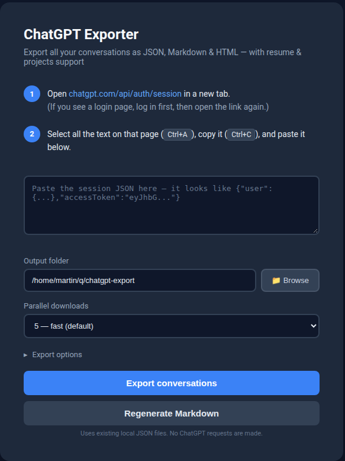
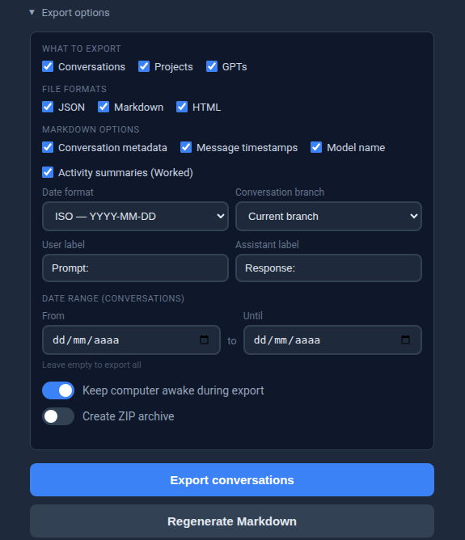

# ChatGPT Exporter

A zero-dependency Node.js tool that exports **all** your ChatGPT data — conversations, projects (with uploaded files), and custom GPTs — to JSON, Markdown, and browseable HTML.

> **About this fork**
>
> This repository is a fork of [ezwep/chatgpt-exporter](https://github.com/ezwep/chatgpt-exporter).
> It keeps the original exporter and adds a number of features that are **currently specific to this fork**.
> Those additions are documented separately below so it is clear which behavior may not exist in the upstream project.



## Why this tool?

OpenAI's built-in data export is slow, gives you a single massive JSON blob, and **doesn't include** custom GPT configurations or project resource files. This tool fills that gap.

## Features

The base project provides:

- **Conversations** — full message history with code blocks, images, and file attachments
- **Projects** — metadata, instructions, uploaded resources (PDFs, documents), and all project conversations organized in subfolders
- **Custom GPTs** — name, description, instructions, tools, and conversation starters
- **3 output formats** — JSON (raw API data), Markdown (readable), HTML (browseable with sidebar)
- **HTML viewer** — generated `index.html` with ChatGPT-style dark sidebar, project folders, and search
- **Parallel downloads** — configurable concurrency (1–10)
- **Date filter** — export only conversations within a specific creation-date range
- **ZIP archive** — optionally bundle everything into a single `.zip`
- **Keep awake** — prevents sleep on macOS (`caffeinate`), Windows (`SetThreadExecutionState`), and Linux (`systemd-inhibit`)
- **Zero dependencies** — only built-in Node.js modules
- **Web UI** — clean local interface, no terminal required after startup

### Additional features in this fork

These features have been added in this fork and may not be available in the upstream project:

- **Smart Resume** — conversations are classified as new, updated, resumed, or failed. Existing JSON is reused when possible, while conversations changed since the previous export are downloaded again.
- **Safer file downloads** — the ChatGPT bearer token is only sent to ChatGPT hosts, never to external signed download URLs.
- **Windows-safe filenames** — exported conversation and file names are sanitized for Windows-compatible paths.
- **Conservative rate limiting** — ChatGPT requests are paced, and the export stops immediately on the first ChatGPT HTTP `429` instead of continuing to generate more rate-limited requests.
- **Regenerate Markdown** — rebuild Markdown from the already exported local JSON without a session token and without making ChatGPT requests.
- **Offline Markdown renderer** — `scripts/render-markdown.js` uses the same Markdown converter as the web UI.
- **Conversation metadata in Markdown** — optional created, updated, exported, and conversation-link fields.
- **Configurable Markdown dates** — ISO (`YYYY-MM-DD`) or European (`DD/MM/YYYY`), with 24-hour timestamps.
- **Message timestamps and model names** — optional per-turn metadata.
- **Custom Prompt / Response labels** — change the Markdown headings without modifying the raw JSON.
- **Conversation branch selection** — export the current ChatGPT branch (default) or every branch stored in the conversation tree.
- **Grouped assistant turns** — intermediate assistant messages and the final answer are kept under a single `Response` heading for each turn.
- **Activity summaries** — optional ChatGPT activity summaries are rendered as quoted **Worked** blocks instead of separate headings, keeping the Markdown table of contents clean.
- **Reliable attachment mapping** — downloaded attachments are mapped by their real ChatGPT file ID rather than guessed from filenames.
- **Unavailable attachments remain visible** — if an old ChatGPT attachment can no longer be downloaded, the Markdown still records its original name instead of silently dropping it.
- **Attachment diagnostics** — `.file-map.json` records successfully downloaded files and files that ChatGPT no longer makes available.

The raw conversation JSON remains the canonical local copy. Markdown can therefore be regenerated later with different formatting options without downloading the conversation again.

## Documentation

See the [User Manual](USER_MANUAL.md) for detailed usage, Smart Resume behavior, Markdown options, archived/deleted conversations, attachments, and ChatGPT-generated `sandbox:/...` files.

## Output structure

```text
chatgpt-export/
├── index.html        ← HTML viewer with search and iframe navigation
├── json/             ← raw conversation JSON
├── markdown/         ← readable Markdown per conversation
├── html/             ← browseable HTML with conversation sidebar
├── files/
│   └── Conversation Name_<id>/
│       ├── .file-map.json  ← exact ChatGPT file ID → local file mapping
│       └── ...             ← downloaded images and attachments
├── projects/
│   └── Project Name/
│       ├── project-info.md
│       ├── resources/    ← uploaded project files (PDFs, images, etc.)
│       ├── json/
│       ├── markdown/
│       └── html/
├── gpts/             ← your custom GPTs as Markdown
└── logs/             ← export run logs
```

## Installation

### Using this fork

The fork-specific features documented above are available when running this repository from source:

```bash
git clone https://github.com/moisescastellano/chatgpt-exporter.git
cd chatgpt-exporter
npm start
```

Requires [Node.js 18+](https://nodejs.org/).

> **Important:** the upstream Windows release and the `chatgpt-full-exporter` npm package belong to the original project. Unless those distributions explicitly incorporate the fork changes, they should not be expected to include the features listed under **Additional features in this fork**.

The browser opens automatically at `http://127.0.0.1:8523`.

### Upstream installation options

If you prefer the packaged releases from the original project rather than the additional features in this fork, see [ezwep/chatgpt-exporter](https://github.com/ezwep/chatgpt-exporter).

The upstream project currently documents these installation methods:

#### Windows standalone

1. Download `chatgpt-exporter-win.zip` from the [upstream latest release](https://github.com/ezwep/chatgpt-exporter/releases/latest)
2. Right-click the zip → **Extract All**
3. Double-click `chatgpt-exporter-win.exe`

#### npx

With Node.js 18+ installed:

```bash
npx chatgpt-full-exporter
```

These methods install/run the **upstream version**, not necessarily this fork.

### Get your session token

After the UI opens in your browser:

1. Open [chatgpt.com/api/auth/session](https://chatgpt.com/api/auth/session) in a new tab (log in first if needed)
2. Select all (`Cmd+A` on macOS, `Ctrl+A` on Windows/Linux), copy, and paste into the text area
3. Choose your output folder
4. Click **Export conversations**

Re-running an export uses Smart Resume: unchanged conversations reuse the existing local JSON, while conversations detected as changed are refreshed.

## Export options

Click **Export options** to expand the main export settings:



| Option | Description |
|--------|-------------|
| Conversations / Projects / GPTs | Toggle which categories to export |
| JSON / Markdown / HTML | Toggle output formats |
| From / Until | Filter conversations by creation date (leave empty = export all) |
| Keep computer awake | Prevent sleep during long exports |
| Create ZIP archive | Bundle output into a `.zip` file |

> **Note:** JSON is always written to disk because it is the canonical local representation used by Smart Resume and Markdown regeneration. It is only included in the ZIP when the JSON format is enabled.

### Markdown options in this fork

| Option | Description |
|--------|-------------|
| Conversation metadata | Add created, updated, exported, and conversation-link fields |
| Message timestamps | Show timestamps for prompts, responses, and optional activity summaries |
| Model name | Show the model used for assistant turns |
| Date format | ISO (`YYYY-MM-DD`) or European (`DD/MM/YYYY`) |
| Conversation branch | Export only the current branch or all branches |
| User label | Customize the prompt heading |
| Assistant label | Customize the response heading |
| Activity summaries (Worked) | Include visible ChatGPT activity summaries as quoted **Worked** blocks |

### Regenerate Markdown

**Regenerate Markdown** rebuilds `.md` files from the JSON already stored in the export directory.

It:

- does **not** require a ChatGPT session token;
- makes **no ChatGPT requests**;
- uses the same Markdown options as a normal export;
- can reuse exact local attachment links stored in `.file-map.json`;
- leaves unavailable attachments visible by name without inventing a local link.

### Offline Markdown rendering

A single conversation JSON can also be rendered from the command line:

```bash
node scripts/render-markdown.js conversation.json output.md
```

Available options include:

```text
--conversation-metadata
--timestamps
--model-name
--thought-process
--date-format <iso|european>
--branch <current|all>
--user-label <label>
--assistant-label <label>
```

`--thought-process` corresponds to **Activity summaries (Worked)** in the web UI.

## Requirements

- **This fork from source:** Node.js 18+
- Supported platforms: macOS, Linux, Windows
- **Upstream Windows standalone:** no Node.js installation required

## Building the Windows executable yourself

The upstream project includes a Windows executable build process:

```bash
npm run build
```

This bundles `server.js` with esbuild and packages it with `pkg`. Output lands in `dist/chatgpt-exporter-win.exe` together with a `dist/public/` folder.

If you build from this fork, verify the resulting executable before distributing it; the primary tested workflow for the fork-specific changes is running from source.

## Troubleshooting

Start the server in debug mode to capture every HTTP request:

```bash
node server.js --debug
```

The `debug.log` file is created alongside the server script. You can also view it at:

```text
http://127.0.0.1:8523/debug-log
```

> **Privacy note:** Debug logs contain API endpoint URLs including conversation and file IDs. Do not share debug logs publicly without reviewing them first.

### HTTP 429 / rate limiting

This fork deliberately stops ChatGPT API activity when the first ChatGPT HTTP `429` is received. This avoids repeatedly retrying against an already rate-limited account.

Wait until ChatGPT requests are available again and start another export. Smart Resume will reuse conversations already saved locally and continue with the remaining work.

A `429` from an external signed file-download host does not by itself stop all ChatGPT requests.

### Old or unavailable attachments

ChatGPT may retain a conversation's attachment metadata after the underlying file can no longer be downloaded.

In that case:

- the Markdown still shows `[Attachment: original-name.ext]`;
- `.file-map.json` records the failed download;
- no guessed or potentially incorrect local link is generated.

## How it works

The tool uses ChatGPT's internal API endpoints (the same ones the web app uses) with your session token. It fetches conversation lists, individual conversations with full message trees, project metadata and resources, and custom GPT configurations.

No third-party API is needed for the export itself. The session token is only sent to ChatGPT hosts; external signed file URLs are downloaded without forwarding that token.

In this fork, the raw JSON is treated as the canonical local conversation data. Markdown is a derived format and can be regenerated offline. Downloaded conversation attachments have an accompanying `.file-map.json` so Markdown regeneration can reproduce exact local file links without filename guessing.

## Disclaimer

**Use at your own risk.** This tool is provided as-is, without warranty of any kind.

- **Unofficial API** — This tool uses ChatGPT's internal web API endpoints, which are undocumented and not part of the official OpenAI API. These endpoints may change, break, or be blocked at any time without notice.
- **Terms of Service** — Using internal API endpoints may violate [OpenAI's Terms of Use](https://openai.com/policies/terms-of-use). You are solely responsible for ensuring your use complies with applicable terms and laws.
- **Session token security** — Your session token grants full access to your ChatGPT account. This tool processes it locally and never transmits it to any third party, but you should **never share your token** with anyone. Treat it like a password.
- **Your own data** — This tool only accesses your own conversations, projects, and GPTs. It is intended for personal data portability, not for accessing other users' data.
- **No affiliation** — This project is not affiliated with, endorsed by, or associated with OpenAI in any way.
- **Rate limiting** — Excessive use may trigger rate limits or temporary blocks on your ChatGPT account. This fork includes pacing and stops ChatGPT requests on the first `429`, but no guarantees are made.
- **Data accuracy** — Exported data is provided as-is from the API. Attachments may no longer be downloadable even when their metadata remains present in a conversation.

## Credits

This fork is based on [**ezwep/chatgpt-exporter**](https://github.com/ezwep/chatgpt-exporter) and retains the upstream project's MIT license and attribution.

The original project was inspired by the browser console export script by [**ocombe**](https://gist.github.com/ocombe/1d7604bd29a91ceb716304ef8b5aa4b5).

Fork-specific changes are maintained independently and are not implied to be part of, supported by, or accepted into the upstream project.

## Support

I do not request donations for maintaining this fork.

If you find the project useful and would like to support its development, please consider supporting **ezwep, the author of the original project**, through the upstream Ko-fi:

[](https://ko-fi.com/ezwep)

## License

MIT
